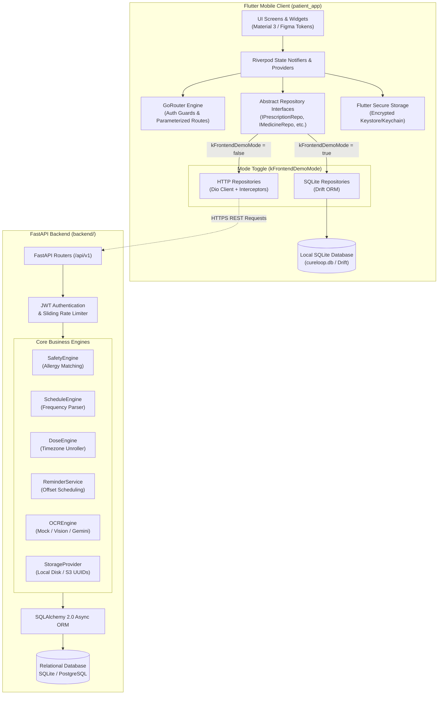
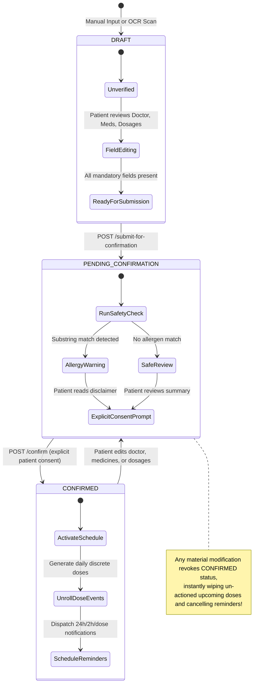
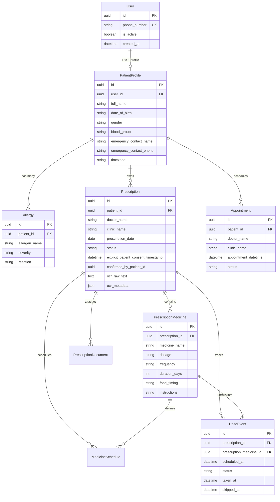

# CureLoop — Comprehensive Master Codebase Documentation

> **System Version:** 1.0.0 (Release Candidate / Offline Prototype & Full-Stack Backend)  
> **Last Updated:** November 2026  
> **Target Audience:** Core Developers, System Architects, Healthcare Compliance Auditors, Academic Evaluators  

---

## Table of Contents

1. [Executive Summary & Product Vision](#1-executive-summary--product-vision)
2. [Dual-Mode Architecture & System Topology](#2-dual-mode-architecture--system-topology)
3. [Core Clinical & Architectural Invariants](#3-core-clinical--architectural-invariants)
4. [Master Repository Map & Directory Layout](#4-master-repository-map--directory-layout)
5. [Frontend Deep Dive (`patient_app/`)](#5-frontend-deep-dive-patient_app)
   - [5.1 State Management (Riverpod)](#51-state-management-riverpod)
   - [5.2 Navigation & Route Hierarchy (GoRouter)](#52-navigation--route-hierarchy-gorouter)
   - [5.3 Local SQLite Persistence Architecture (Drift)](#53-local-sqlite-persistence-architecture-drift)
   - [5.4 Network, Security & Environment Configuration](#54-network-security--environment-configuration)
   - [5.5 Design System & UI Tokens](#55-design-system--ui-tokens)
   - [5.6 Feature Modules Breakdown](#56-feature-modules-breakdown)
6. [Backend Deep Dive (`backend/`)](#6-backend-deep-dive-backend)
   - [6.1 Framework & Middleware Pipeline](#61-framework--middleware-pipeline)
   - [6.2 Authentication, JWT & Security Architecture](#62-authentication-jwt--security-architecture)
   - [6.3 Relational Database Schema & ORM (SQLAlchemy)](#63-relational-database-schema--orm-sqlalchemy)
   - [6.4 Core Business & Safety Engines](#64-core-business--safety-engines)
   - [6.5 Complete REST API Specification](#65-complete-rest-api-specification)
7. [Design System & Figma Specifications (`figma_handoff/`)](#7-design-system--figma-specifications-figma_handoff)
8. [Testing & Quality Assurance Suite](#8-testing--quality-assurance-suite)
   - [8.1 Flutter Test Suite](#81-flutter-test-suite)
   - [8.2 Backend Pytest Suite](#82-backend-pytest-suite)
   - [8.3 End-to-End Automated Testing](#83-end-to-end-automated-testing)
9. [Operations, Setup & Deployment Guide](#9-operations-setup--deployment-guide)
   - [9.1 Running Offline Frontend Prototype](#91-running-offline-frontend-prototype)
   - [9.2 Running Full-Stack Mode (FastAPI + Flutter)](#92-running-full-stack-mode-fastapi--flutter)
   - [9.3 Building & Distributing Android Release APK](#93-building--distributing-android-release-apk)
10. [Future Roadmap & Production Hardening](#10-future-roadmap--production-hardening)

---

## 1. Executive Summary & Product Vision

### 1.1 The Problem
Medication non-adherence and prescription misinterpretation remain among the leading causes of preventable hospitalizations worldwide:
- **Illegible or Misunderstood Prescriptions:** Patients frequently receive complex handwritten prescriptions with cryptic Latin abbreviations (`1-0-1`, `TID`, `PC`), resulting in incorrect dosages or timing.
- **Silent Drug-Allergy Hazards:** Prescriptions written by different doctors rarely check across existing historical allergies, leading to dangerous cross-reactions (e.g., prescribing Amoxicillin to a patient allergic to Penicillin).
- **Missed Doses & Forgotten Refills:** Without proactive, timezone-aware reminder schedules, chronic patients fail to follow regimes.
- **Fragmented Medical Records:** Patient history, doctor appointments, family dependents, and emergency contacts are scattered across loose paper documents.

### 1.2 The CureLoop Solution
**CureLoop** is an intelligent, patient-centric healthcare companion engineered to bridge the gap between doctor prescription and patient adherence:
1. **Prescription Digitization & Mock OCR:** Converts photographed prescriptions into structured, machine-readable digital records with field-level confidence indicators.
2. **Automated Safety & Contraindication Checking:** Real-time cross-referencing between active prescribed medications and the patient's allergy profile before any medication schedule is landed.
3. **Strict Patient Consent Safeguard:** Enforces an unbypassable clinical guardrail: reminders and active dose schedules are **never** activated automatically by OCR or uploads until the patient has explicitly reviewed and confirmed the details.
4. **Timezone-Aware Adherence Tracking:** Daily dose events (`TAKEN`, `SKIPPED`, `SCHEDULED`) unrolled according to patient-local daily schedules with single-tap tracking.
5. **Centralized Medical Vault & Emergency Access:** Consolidated access to past prescriptions, upcoming appointments, family profiles, and a high-contrast emergency card for first responders.

---

## 2. Dual-Mode Architecture & System Topology

CureLoop employs a versatile dual-mode architecture that enables **100% offline standalone demonstration** (ideal for academic presentations, device testing, and air-gapped environments) alongside a **production-ready full-stack REST API** powered by FastAPI and relational databases.



### Modes Breakdown
| Feature / Characteristic | Standalone Offline Mode (`kFrontendDemoMode = true`) | Full-Stack Mode (`kFrontendDemoMode = false`) |
| :--- | :--- | :--- |
| **Network Required** | **No** (0 network calls; air-gapped safe) | **Yes** (Connects to backend over HTTP/HTTPS) |
| **Local Storage Engine** | Drift SQLite (`AppDatabase`) | Flutter Secure Storage (JWT cache only) |
| **Database File** | Sandboxed device SQLite (`cureloop_patient.db`) | Server PostgreSQL or server SQLite (`cureloop.db`) |
| **Authentication** | Local simulated OTP (`1234`) with instant bypass | Real phone SMS / MockOTP with cryptographic JWTs |
| **OCR Pipeline** | Deterministic Mock OCR engine with fixture parsing | Backend OCR parser (`/api/v1/prescriptions/ocr`) |
| **Allergy & Safety Engine** | Client-side reactive cross-matching in Dart | Server-side `SafetyEngine` in Python |
| **Dose Generation** | Local DAO unrolls schedules into `dose_events` table | `dose_engine.py` unrolls schedules into DB |

---

## 3. Core Clinical & Architectural Invariants

CureLoop enforces non-negotiable software and clinical safety invariants to guarantee patient data integrity and prevent medical errors.

### 3.1 The Inviolable Confirmation Invariant
> **CLINICAL RULE:** An uploaded prescription or machine-generated OCR output **MUST NEVER** automatically trigger reminders, generate active dose schedules, or notify the patient without explicit manual confirmation.



### 3.2 Substring Allergy Matching Guard
When evaluating safety between active prescriptions and patient allergies:
1. **Conservative Substring Matching:** If an allergen name (e.g., `Penicillin`) is a substring of the medicine name (e.g., `Penicillin V`), or vice versa, a `POTENTIAL_ALLERGY_MATCH` is flagged immediately.
2. **Conservative Fallback:** In the absence of an integrated full pharmacological knowledge graph, the engine **never** claims a prescription is 100% safe. If no string match is found, it reports `UNABLE_TO_DETERMINE` accompanied by a mandatory disclaimer:
   > *"Allergy checks are an informational safety aid. Always confirm medicines with your doctor or pharmacist."*

### 3.3 Zero-Silent-Assumption OCR Policy
When scanning handwritten or damaged prescriptions:
- The system **never** silently defaults missing dosages (e.g., defaulting to 500mg).
- The system **never** silently defaults missing durations (e.g., defaulting to 7 days).
- Any unreadable field is categorized as `UNKNOWN` with a low-confidence flag. Prescriptions containing `UNKNOWN` fields are hard-blocked from submission until the patient supplies the missing information.

---

## 4. Master Repository Map & Directory Layout

```text
CURELOOP/
├── README.md                      # Professional project landing & setup guide
├── DEVELOPMENT.md                 # Full-stack developer reference & phase log
├── TODO.md                        # Architecture milestone tracking
├── docker-compose.yml             # Docker container orchestration (PostgreSQL)
├── .env.example                   # Backend environment configuration template
├── e2e_tester.py                  # Automated full-stack verification script
├── fix_dio.dart                   # Dio compatibility helper utility
│
├── figma_handoff/                 # UI/UX Specifications & Assets
│   ├── design_spec.md             # Complete design token & layout manual
│   └── screens/                   # 23 PNG visual source-of-truth mockups
│       ├── onboarding-carousel-[1-3].png
│       ├── phone-entry.png / otp-verification.png
│       ├── home-dashboard.png / home-empty-state.png
│       ├── vault-list.png / vault-detail.png / vault-empty.png
│       ├── add-prescription-choice.png / reminder-notification.png
│       ├── appointments-list.png / add-appointment.png / appointment-detail.png
│       ├── allergy-profile.png / emergency-card.png / family-profiles.png
│       └── settings-profile.png / canvas.png
│
├── docs/                          # Specialized Technical Documentation
│   ├── FULL_CODEBASE_DOCUMENTATION.md  # (THIS DOCUMENT) Comprehensive master manual
│   ├── PHASE10_OCR_VALIDATION.md       # Real-world & mock OCR extraction audit
│   └── PHASE10_REAL_DEVICE_TEST.md     # Physical Android device verification report
│
├── backend/                       # FastAPI REST API Services
│   ├── alembic.ini                # Alembic database migration config
│   ├── requirements.txt           # Python dependency declarations
│   ├── pytest.ini                 # Pytest test suite configuration
│   ├── cureloop.db                # Development SQLite database instance
│   ├── app/
│   │   ├── main.py                # FastAPI entry point, CORS, router mounting
│   │   ├── core/                  # Security, tokens, settings
│   │   │   ├── config.py          # Pydantic Settings (.env loader)
│   │   │   └── security.py        # Passwords, JWT encoding/decoding, get_current_user
│   │   ├── db/                    # Database session & base definitions
│   │   │   ├── database.py        # Async engine & get_db dependency
│   │   │   └── base_class.py      # DeclarativeBase with custom helpers
│   │   ├── models/                # SQLAlchemy Relational Models
│   │   │   ├── user.py            # User credentials & authentication model
│   │   │   ├── patient.py         # PatientProfile model
│   │   │   ├── allergy.py         # Allergy model
│   │   │   ├── prescription.py    # Prescription, Medicine, Schedule, DoseEvent, Document
│   │   │   └── appointment.py     # Appointment model
│   │   ├── schemas/               # Pydantic Validation & Serialization Schemas
│   │   │   ├── user.py, patient.py, allergy.py, prescription.py, appointment.py, dose.py, ocr.py
│   │   ├── services/              # Domain Business Logic & Subsystems
│   │   │   ├── safety_engine.py   # Allergy & Contraindication matching
│   │   │   ├── schedule_engine.py # Daily frequency parser (e.g., 1-0-1 -> Morning/Night)
│   │   │   ├── dose_engine.py     # Discrete dose unroller & idempotency manager
│   │   │   ├── reminder_service.py# Notification dispatcher (24h/2h offsets)
│   │   │   ├── ocr_engine.py      # Abstract OCR provider & regex entity extractor
│   │   │   ├── storage_provider.py# UUID-based file vault (local disk & S3 abstraction)
│   │   │   ├── otp_service.py     # OTP generation & verification (Mock / Twilio)
│   │   │   ├── rate_limiter.py    # Sliding-window rate limiter
│   │   │   └── pdf_export.py      # Prescription PDF export service
│   │   └── api/v1/                # Endpoint Route Handlers
│   │       ├── auth.py            # /auth (request-otp, verify-otp, refresh)
│   │       ├── patient.py         # /patient (profile CRUD, account deletion)
│   │       ├── allergy.py         # /allergies (allergy CRUD)
│   │       ├── prescription.py    # /prescriptions (CRUD, OCR, review, safety, confirm, vault)
│   │       ├── appointment.py     # /appointments (CRUD, status toggles)
│   │       └── doses.py           # /doses (today, upcoming, history, taken, skip)
│   └── tests/                     # 21 Asynchronous Integration Tests
│       ├── test_auth.py, test_patient.py, test_allergy.py, test_prescription.py
│       ├── test_phase3_safety.py, test_phase4_vault.py, test_phase5_doses.py
│       ├── test_phase6_appointments.py, test_phase7_ocr.py, test_phase9_security.py
│       └── conftest.py            # Test database fixture & authenticated clients
│
└── patient_app/                   # Flutter Mobile Application
    ├── pubspec.yaml               # Flutter package configuration & dependencies
    ├── analysis_options.yaml      # Strict Flutter lint rules
    ├── android/                   # Android native harness & manifests
    │   └── app/src/main/AndroidManifest.xml # Security & allowBackup="false"
    ├── test/                      # 20 Flutter Unit & Widget Tests
    │   ├── database_test.dart     # Drift SQLite CRUD, foreign keys, cascades, reopen
    │   ├── initial_test.dart      # Smoke tests
    │   ├── medicine_test.dart     # DoseCard widget test
    │   ├── appointment_test.dart  # AppointmentCard widget test
    │   └── ocr_models_test.dart   # OCR model serialization test
    └── lib/
        ├── main.dart              # Flutter application bootstrap & eager DB init
        ├── core/                  # Cross-cutting Infrastructure
        │   ├── config/            # dev_config.dart (kFrontendDemoMode switch)
        │   ├── database/          # Drift SQLite Engine
        │   │   ├── tables.dart    # 8 Relational SQLite table definitions
        │   │   ├── app_database.dart # AppDatabase class, migrations & seeding
        │   │   ├── connection/    # Native SQLite connection factory
        │   │   ├── daos/          # ProfileDao, PrescriptionDao, MedicineDao, AppointmentDao
        │   │   └── repositories/  # Sqlite*Repository implementations
        │   ├── error/             # AppError definitions & exceptions
        │   ├── network/           # DioClient, interceptors, token refresh
        │   ├── routing/           # router.dart (GoRouter configuration & auth guards)
        │   ├── storage/           # secure_storage.dart (FlutterSecureStorage wrapper)
        │   ├── theme/             # app_colors.dart, app_typography.dart, app_theme.dart
        │   └── widgets/           # cureloop_logo.dart & shared primitives
        └── features/              # Feature Domain Modules
            ├── auth/              # login_screen.dart, otp_screen.dart, auth_repository.dart
            ├── onboarding/        # onboarding_screen.dart (3-page carousel)
            ├── home/              # home_screen.dart (Dashboard, tabs, FAB, cards)
            ├── prescriptions/     # Vault, Manual Entry, OCR Review, Safety, Confirmation
            ├── medicines/         # medicines_screen.dart, dose_card.dart, tracking
            ├── appointments/      # appointments_screen.dart, add_appointment, detail
            └── profile/           # profile_screen.dart, setup, allergies, family, emergency
```

---

## 5. Frontend Deep Dive (`patient_app/`)

### 5.1 State Management (Riverpod)
The application utilizes **Riverpod 2.0** (`flutter_riverpod` and `riverpod_annotation`). State management follows these architectural patterns:
1. **Repository Provider Pattern:** Repositories are exposed via providers (`prescriptionRepositoryProvider`, `medicineRepositoryProvider`, `appointmentRepositoryProvider`, `profileRepositoryProvider`).
2. **Conditional Mode Injection:**
   ```dart
   @riverpod
   IPrescriptionRepository prescriptionRepository(PrescriptionRepositoryRef ref) {
     if (kFrontendDemoMode) {
       final db = ref.watch(appDatabaseProvider);
       return SqlitePrescriptionRepository(db);
     }
     return HttpPrescriptionRepository(ref.watch(dioClientProvider));
   }
   ```
3. **AsyncNotifier Architecture:** Complex domain states (such as active dose events and prescription lists) utilize `AsyncNotifier` to cleanly handle loading, error, and data states without UI boilerplate.

### 5.2 Navigation & Route Hierarchy (GoRouter)
Routing is managed declaratively in [`lib/core/routing/router.dart`](file:///d:/STUDY/COLLEGE/SEM-VII/CURELOOP/patient_app/lib/core/routing/router.dart) using `GoRouter`.
- **Top-Level Authentication Guards:**
  - Evaluates `authTokenStorageProvider` and `kDevSkipAuth`.
  - Unauthenticated requests outside `/login` or `/otp` automatically redirect to `/login`.
  - Authenticated users attempting to navigate to auth screens redirect back to Home (`/`).
- **Complete Route Tree:**
  | Route Path | Screen Widget | Purpose / Arguments |
  | :--- | :--- | :--- |
  | `/` | `HomeScreen` | Home Dashboard with bottom navigation tabs |
  | `/onboarding` | `OnboardingScreen` | 3-page introduction carousel with indicators |
  | `/login` | `LoginScreen` | Phone number entry for OTP authentication |
  | `/otp` | `OtpScreen` | 4-digit code verification (queryParam: `phone`) |
  | `/prescriptions/add` | `AddPrescriptionChoiceScreen` | Choice modal: "Scan Prescription" vs "Manual Entry" |
  | `/prescriptions/add/manual`| `ManualPrescriptionScreen` | Structured multi-medicine prescription form |
  | `/prescriptions/ocr-review`| `OcrReviewScreen` | Field verification screen (extra: `OCRExtractionResponse`) |
  | `/prescriptions/:id/review`| `PrescriptionReviewScreen` | Full draft inspection and edit before submission |
  | `/prescriptions/:id/safety`| `SafetyCheckScreen` | Contraindication and allergy match report |
  | `/prescriptions/:id/confirm`| `PrescriptionConfirmationScreen` | Explicit patient consent toggle & activation |
  | `/appointments/add` | `AddAppointmentScreen` | Doctor appointment booking form |
  | `/appointments/:id` | `AppointmentDetailScreen` | View/cancel/complete specific appointment |
  | `/profile/setup` | `ProfileSetupScreen` | Edit patient demographics, blood group, contact |
  | `/profile/allergies` | `AllergyProfileScreen` | View, add, and remove patient allergies |
  | `/profile/family` | `FamilyProfilesScreen` | View dependent family members |
  | `/profile/family/add` | `AddFamilyMemberScreen` | Add family dependent profile |
  | `/profile/emergency` | `EmergencyCardScreen` | High-visibility emergency medical summary card |

### 5.3 Local SQLite Persistence Architecture (Drift)
The persistence layer in [`lib/core/database/`](file:///d:/STUDY/COLLEGE/SEM-VII/CURELOOP/patient_app/lib/core/database/) is implemented using **Drift** (type-safe SQLite ORM for Dart):

#### Database Schema & Tables
Defined in [`tables.dart`](file:///d:/STUDY/COLLEGE/SEM-VII/CURELOOP/patient_app/lib/core/database/tables.dart):
1. **`PatientProfiles`:** `id` (PK), `name`, `phone`, `email`, `dateOfBirth`, `bloodGroup`, `emergencyContactName`, `emergencyContactPhone`, timestamps.
2. **`Prescriptions`:** `id` (PK), `patientId` (Indexed), `doctorName`, `clinicName`, `prescriptionDate`, `notes`, `status` (`DRAFT`, `PENDING_CONFIRMATION`, `CONFIRMED`).
3. **`PrescriptionMedicines`:** `id` (PK), `prescriptionId` (FK -> `Prescriptions.id` CASCADE), `medicineName`, `dosage`, `frequency`, `durationDays`, `foodTiming`, `instructions`.
4. **`MedicineSchedules`:** `id` (PK), `prescriptionId` (FK CASCADE), `prescriptionMedicineId` (FK CASCADE), `medicineName`, `dosage`, `frequency`, `timesPerDay`, `startDate`, `endDate`, `isActive`.
5. **`DoseEvents`:** `id` (PK), `prescriptionId` (FK CASCADE), `prescriptionMedicineId` (FK CASCADE), `scheduleId` (FK CASCADE), `medicineName`, `dosage`, `scheduledAt`, `status` (`SCHEDULED`, `TAKEN`, `SKIPPED`, `MISSED`), `foodTiming`, `takenAt`, `skippedAt`, `skipReason`.
6. **`Appointments`:** `id` (PK), `patientId`, `doctorName`, `clinicName`, `appointmentDatetime`, `timezone`, `notes`, `status` (`scheduled`, `completed`, `cancelled`).
7. **`Allergies`:** `id` (PK), `patientId`, `name`, `severity` (`Low`, `Medium`, `High`), `reaction`.
8. **`FamilyMembers`:** `id` (PK), `patientId`, `name`, `relation`, `dateOfBirth`.

#### Integrity & Lifecycle Features
- **Foreign Key Enforcement:** SQLite foreign keys are explicitly enabled on startup via `PRAGMA foreign_keys = ON;`.
- **Cascade Deletion:** Deleting a prescription automatically cascades and purges associated medicines, schedules, and un-actioned dose events.
- **Eager Seeding:** [`AppDatabase.seedInitialData()`](file:///d:/STUDY/COLLEGE/SEM-VII/CURELOOP/patient_app/lib/core/database/app_database.dart) seeds demo patient `Jane Doe` (`O+`), baseline allergies (`Penicillin`, `Peanuts`), active prescription for `Metformin 500mg` & `Amlodipine 5mg`, upcoming dose events, and appointments.
- **Entity Disambiguation:** Uses `@DataClassName('*Entity')` to prevent naming collisions between generated Drift entities and domain Pydantic/Dart models.

### 5.4 Network, Security & Environment Configuration
- **Android Sandboxing:** In [`android/app/src/main/AndroidManifest.xml`](file:///d:/STUDY/COLLEGE/SEM-VII/CURELOOP/patient_app/android/app/src/main/AndroidManifest.xml), `android:allowBackup="false"` is enforced. This prevents ADB extraction of sensitive medical SQLite files and keystore tokens.
- **Dio Client Interceptor:** The HTTP client in `dio_client.dart` injects `Authorization: Bearer <token>` into outgoing requests. When receiving a `401 Unauthorized`, it attempts a silent token refresh using the stored `refresh_token` before retrying or logging out.
- **Dev Configuration Flags:** In [`dev_config.dart`](file:///d:/STUDY/COLLEGE/SEM-VII/CURELOOP/patient_app/lib/core/config/dev_config.dart):
  - `kFrontendDemoMode = true`: Keeps the frontend completely decoupled from the network.
  - `kDevSkipAuth = true`: Enables instant access to the dashboard during presentations.

### 5.5 Design System & UI Tokens
Aligned with [`figma_handoff/design_spec.md`](file:///d:/STUDY/COLLEGE/SEM-VII/CURELOOP/figma_handoff/design_spec.md):
- **Color Palette (`AppColors`):**
  - Primary Teal: `#2E9E8C` (Buttons, active tabs, success badges)
  - Dark Navy: `#1B2A4E` (Headings, primary typography, deep accents)
  - Background Neutral: `#FAFAFA`
  - Surface White: `#FFFFFF`
  - Warning Accent: `#D97706` (Text) / `#FFF4EC` (Fill) / `#F4A261` (Border)
  - Error Accent: `#E53E3E`
- **Typography (`AppTypography`):** High legibility scale using Roboto:
  - Display: 28sp Bold
  - H1 / H2 / H3: 24sp / 20sp / 18sp Semi-bold
  - Body Large / Medium / Small: 16sp / 14sp / 12sp
- **Elevation & Corners:** Standardized 12px border radius on cards, input fields, and action buttons with subtle drop shadows (`blurRadius: 10`, `alpha: 0.05`).

### 5.6 Feature Modules Breakdown

#### Home Dashboard
The central command center (`HomeScreen`). Displays:
- Welcome banner personalized with patient name (`Jane Doe`).
- **Quick Health Status:** Adherence percentage and count of pending doses today.
- **Today's Dose Feed:** Horizontal or vertical list of upcoming doses with inline **Taken** and **Skip** buttons that update SQLite immediately.
- **Upcoming Appointments Card:** Displays nearest scheduled consultation with countdown badge.
- **Floating Action Button:** Instant shortcut to `/prescriptions/add`.
- **Bottom Navigation Bar:** Seamless switching between Home, Vault, Medicines, Appointments, and Profile.

#### Prescription Vault & OCR Flow
- **Vault List:** Searchable archive of all prescriptions. Cards display doctor name, clinic, prescription date, number of medications, and visual status badges (`DRAFT` in amber, `PENDING` in blue, `CONFIRMED` in teal).
- **OCR Review (`OcrReviewScreen`):** Simulates intelligent document scanning. Extracted fields carry color-coded confidence pills:
  - `HIGH` (Green): Verified with high confidence.
  - `MEDIUM` (Yellow): Needs visual verification.
  - `UNKNOWN` (Red): Empty or unreadable; user must tap to fill before submission.
- **Safety Check (`SafetyCheckScreen`):** Summarizes potential drug-allergy interactions. If a patient is allergic to `Penicillin` and prescribed `Amoxicillin`, a prominent alert card warns the user with clinical guidance.
- **Prescription Confirmation (`PrescriptionConfirmationScreen`):** Displays medication timings, dosages, and instructions. The patient must check the acknowledgment checkbox before tapping **Confirm & Activate Reminders**.

#### Medicines & Adherence Tracking
- Filterable views: **Today**, **Upcoming**, and **History**.
- Each dose card displays the medication name, dosage strength, food instructions (`Before food`, `After food`), and scheduled time.
- Tapping **Taken** marks the dose in SQLite with `takenAt = DateTime.now()` and turns the card into a green completed state.
- Tapping **Skip** prompts for an optional reason and marks the dose as skipped.

#### Appointments
- Categorized into **Upcoming** and **Past**.
- Add appointment modal records doctor name, clinic name, date, time, and special instructions.
- Detail view allows cancelling or marking the appointment as completed.

#### Profile, Allergies, Family & Emergency Card
- **Allergy Profile:** Allows adding allergens with severity levels (`Low`, `Medium`, `High`) and reaction types (`Hives`, `Anaphylaxis`).
- **Family Profiles:** Enables tracking dependent family members (e.g., spouse, children, elderly parents).
- **Emergency Medical Card:** High-contrast, easily accessible screen designed for paramedics and emergency physicians, highlighting blood type (`O+`), active critical medications, severe allergies, and one-touch calling for the emergency contact.

---

## 6. Backend Deep Dive (`backend/`)

### 6.1 Framework & Middleware Pipeline
The backend is built with **FastAPI** on Python 3.13:
- **CORS Middleware:** Configurable via `settings.CORS_ORIGINS`. Enforces strict origin control in production while permitting local mobile emulator connections in development (`http://localhost`, `http://10.0.2.2`).
- **Dependency Injection:** Database sessions are provisioned via `get_db()`, yielding an async `AsyncSession` per request with automatic rollback on unhandled exceptions.
- **Health Check Endpoint:** `GET /health` provides uptime monitoring and reports active environment status (`development` / `production`).

### 6.2 Authentication, JWT & Security Architecture
- **Dual-Token System:**
  - `access_token`: Short-lived (30 minutes) HS256 JWT containing `sub: <user_id>`. Used for all protected endpoints via `get_current_user`.
  - `refresh_token`: Long-lived (7 days) HS256 JWT containing `sub: <user_id>` and `type: refresh`. Stored securely on the mobile device.
- **Sliding-Window Rate Limiter (`RateLimiter`):**
  - Protects against SMS bombing and brute-force verification.
  - Max 5 OTP requests per 10 minutes per IP/Phone combination.
  - Max 10 verification attempts per 10 minutes.
- **Patient Isolation:** Every data query enforces `where(Model.patient_id == current_patient.id)`. Users can never read, modify, or delete another patient's medical records.

### 6.3 Relational Database Schema & ORM (SQLAlchemy)



### 6.4 Core Business & Safety Engines

#### SafetyEngine (`app/services/safety_engine.py`)
- Evaluates active prescription medicines against recorded allergies.
- Returns `SafetyResult(status, message, matched_allergies)`.
- Validates the safety guardrail via `can_activate_reminders(prescription)`.

#### ScheduleEngine (`app/services/schedule_engine.py`)
Parses medical shorthand and standard frequency expressions into time slots:
- `1-0-1`: Morning (08:00) and Night (20:00).
- `1-1-1`: Morning (08:00), Afternoon (13:00), and Night (20:00).
- `Once daily`: Morning (08:00).
- `Twice daily`: Morning (08:00) and Night (20:00).
- `QID` / `4 times daily`: 08:00, 12:00, 16:00, 20:00.

#### DoseEngine (`app/services/dose_engine.py`)
- Unrolls schedules across the full `duration_days` into individual `DoseEvent` records in UTC.
- Respects the patient's local timezone (via Python standard library `zoneinfo`).
- **Idempotency Guarantee:** If a prescription is re-confirmed after edits, existing `TAKEN` and `SKIPPED` records are strictly preserved, while upcoming un-actioned doses are refreshed.

#### ReminderService (`app/services/reminder_service.py`)
- Interfaces with an abstract `NotificationProvider`.
- Schedules local or push notifications for upcoming dose events.
- Dispatches appointment notifications at **24 hours** and **2 hours** before the scheduled consultation time.
- Automatically cancels future reminders if a prescription or appointment is edited or deleted.

#### StorageProvider (`app/services/storage_provider.py`)
- Secure private object storage abstraction.
- Generates unpredictable UUID object keys (`uuid.uuid4()`) to prevent enumeration attacks.
- Validates file MIME types (`image/jpeg`, `image/png`, `application/pdf`) and enforces a 10MB file size ceiling.
- `LocalStorageProvider` handles local file reads/writes with path traversal protection; easily swapped for `S3StorageProvider` in production.

#### OCREngine (`app/services/ocr_engine.py`)
- Implements `BaseOCRProvider` with deterministic `MockOCRProvider`.
- Simulates clean, messy, missing dosage, and ambiguous prescription image fixtures.
- `PrescriptionExtractor` parses raw text into candidate medicines with confidence scoring (`HIGH`, `MEDIUM`, `LOW`, `UNKNOWN`).

### 6.5 Complete REST API Specification

| Domain | Method | Endpoint Path | Auth Required | Request Body / Query | Success Response |
| :--- | :--- | :--- | :--- | :--- | :--- |
| **Auth** | `POST` | `/api/v1/auth/request-otp` | No | `{"phone_number": "+1234567890"}` | `200 OK` (OTP sent) |
| **Auth** | `POST` | `/api/v1/auth/verify-otp` | No | `{"phone_number": "...", "otp": "1234"}`| `200 OK` (Tokens) |
| **Auth** | `POST` | `/api/v1/auth/refresh` | No | `{"refresh_token": "..."}` | `200 OK` (New Access Token) |
| **Patient** | `POST` | `/api/v1/patient` | Yes | `PatientProfileCreate` | `201 Created` (`PatientProfileResponse`) |
| **Patient** | `GET` | `/api/v1/patient` | Yes | None | `200 OK` (`PatientProfileResponse`) |
| **Patient** | `PUT` | `/api/v1/patient` | Yes | `PatientProfileUpdate` | `200 OK` (`PatientProfileResponse`) |
| **Patient** | `DELETE`| `/api/v1/patient` | Yes | None (Cascade purges user & data) | `204 No Content` |
| **Allergy** | `POST` | `/api/v1/allergies` | Yes | `AllergyCreate` | `201 Created` (`AllergyResponse`) |
| **Allergy** | `GET` | `/api/v1/allergies` | Yes | None | `200 OK` (`list[AllergyResponse]`) |
| **Allergy** | `DELETE`| `/api/v1/allergies/{id}` | Yes | Path ID | `204 No Content` |
| **Prescription** | `POST` | `/api/v1/prescriptions` | Yes | `PrescriptionCreate` | `201 Created` (`PrescriptionResponse`) |
| **Prescription** | `GET` | `/api/v1/prescriptions` | Yes | Query: `query`, `status`, `page` | `200 OK` (`list[PrescriptionResponse]`) |
| **Prescription** | `GET` | `/api/v1/prescriptions/{id}` | Yes | Path ID | `200 OK` (`PrescriptionResponse`) |
| **Prescription** | `PUT` | `/api/v1/prescriptions/{id}` | Yes | `PrescriptionUpdate` | `200 OK` (Reverts confirmation if material) |
| **Prescription** | `DELETE`| `/api/v1/prescriptions/{id}` | Yes | Path ID | `204 No Content` (Cancels reminders) |
| **Prescription** | `POST` | `/api/v1/prescriptions/ocr` | Yes | Multipart File (Image max 5MB) | `201 Created` (`OCRExtractionResponse`) |
| **Prescription** | `POST` | `/api/v1/prescriptions/{id}/submit-for-confirmation` | Yes | Path ID | `200 OK` (Transitions to PENDING) |
| **Prescription** | `GET` | `/api/v1/prescriptions/{id}/safety-check` | Yes | Path ID | `200 OK` (`SafetyResult`) |
| **Prescription** | `POST` | `/api/v1/prescriptions/{id}/confirm` | Yes | Path ID | `200 OK` (Generates doses & reminders) |
| **Prescription** | `POST` | `/api/v1/prescriptions/{id}/documents` | Yes | Multipart File (PDF/JPEG/PNG) | `201 Created` (`PrescriptionDocumentResponse`)|
| **Prescription** | `GET` | `/api/v1/prescriptions/documents/{key}` | Yes | Object Key | `200 OK` (`FileResponse` stream) |
| **Prescription** | `GET` | `/api/v1/prescriptions/{id}/export/pdf` | Yes | Path ID | `200 OK` (`application/pdf`) |
| **Doses** | `GET` | `/api/v1/doses/today` | Yes | None | `200 OK` (`list[DoseEventResponse]`) |
| **Doses** | `GET` | `/api/v1/doses/upcoming` | Yes | None | `200 OK` (`list[DoseEventResponse]`) |
| **Doses** | `GET` | `/api/v1/doses/history` | Yes | None | `200 OK` (`list[DoseEventResponse]`) |
| **Doses** | `POST` | `/api/v1/doses/{id}/taken` | Yes | Path ID | `200 OK` (`status: TAKEN`) |
| **Doses** | `POST` | `/api/v1/doses/{id}/skip` | Yes | Path ID | `200 OK` (`status: SKIPPED`) |
| **Appointments** | `POST` | `/api/v1/appointments` | Yes | `AppointmentCreate` | `201 Created` (`AppointmentResponse`) |
| **Appointments** | `GET` | `/api/v1/appointments` | Yes | Query: `filter` (`upcoming`/`past`/`all`) | `200 OK` (`list[AppointmentResponse]`) |
| **Appointments** | `GET` | `/api/v1/appointments/{id}` | Yes | Path ID | `200 OK` (`AppointmentResponse`) |
| **Appointments** | `PUT` | `/api/v1/appointments/{id}` | Yes | `AppointmentUpdate` | `200 OK` (`AppointmentResponse`) |
| **Appointments** | `DELETE`| `/api/v1/appointments/{id}` | Yes | Path ID | `204 No Content` |
| **Appointments** | `POST` | `/api/v1/appointments/{id}/complete`| Yes | Path ID | `200 OK` (`status: completed`) |

---

## 7. Design System & Figma Specifications (`figma_handoff/`)

The mobile user interface was built to match the pixel-accurate Figma export package located in [`figma_handoff/`](file:///d:/STUDY/COLLEGE/SEM-VII/CURELOOP/figma_handoff/):
- **PNG-Only Source of Truth:** High-fidelity raster PNGs served as the visual guideline for layout, whitespace, hierarchy, and icon styles without reliance on third-party SVG assets.
- **Card Styling Invariants:**
  - Background: Pure White (`#FFFFFF`).
  - Border: 1px solid Border Gray (`#E2E8F0`).
  - Radius: Rounded rectangles with 12px corner radii.
  - Padding: 16px horizontal and 16px vertical interior padding.
- **Button Tokens:**
  - Height: 52px minimum touch target height.
  - Border radius: 12px.
  - Elevation: Flat (0 elevation) with solid primary teal background and white semi-bold text.

---

## 8. Testing & Quality Assurance Suite

CureLoop maintains full test coverage across both the Flutter mobile client and the Python FastAPI backend.

### 8.1 Flutter Test Suite (`patient_app/test/`)
Tested via `flutter test`. **20/20 tests passing cleanly:**
1. **`database_test.dart` (Integration & SQLite Persistence):**
   - Verifies eager seeding of patient `Jane Doe`, initial allergies, and family members.
   - Verifies confirmed demo prescription `demo-rx-1` and initial dose events.
   - Tests insertion, updating, and querying of patient profiles.
   - Tests cascade deletion: deleting a prescription cleanly removes all associated medicines, schedules, and dose events.
   - Tests status transitions: updates to prescription metadata properly invalidate confirmation.
   - Tests dose adherence: marking doses as `TAKEN` and `SKIPPED` records exact timestamps.
   - Tests appointment lifecycle (create, complete, filter by upcoming/past).
   - Tests database close and reopen: guarantees data survives process restart.
2. **`appointment_test.dart` & `medicine_test.dart` (Widget Testing):**
   - Verifies `AppointmentCard` renders doctor, clinic, and formatted datetime correctly.
   - Verifies `DoseCard` displays medicine title, dosage, instructions, and interactive action buttons.
3. **`ocr_models_test.dart`:**
   - Validates JSON serialization and parsing of OCR confidence score enums.

### 8.2 Backend Pytest Suite (`backend/tests/`)
Tested via `pytest -v`. **21/21 asynchronous integration tests passing in ~1.1s:**
- `test_auth.py`: OTP issuance, successful verification, and rejection of invalid codes.
- `test_patient.py`: Profile creation, reading, and account deletion cascade.
- `test_allergy.py`: Allergy CRUD and strict patient-level data isolation.
- `test_prescription.py`: Manual prescription creation, schedule generation, and multi-tenant isolation.
- `test_phase3_safety.py`: Substring allergy detection and unconfirmed reminder guard.
- `test_phase4_vault.py`: Prescription search filtering and private document upload/download.
- `test_phase5_doses.py`: Daily dose unrolling, local timezone conversion, and idempotent re-confirmation.
- `test_phase6_appointments.py`: Appointment booking, 24h/2h notification scheduling, and completion.
- `test_phase7_ocr.py`: Mock OCR processing and structured field extraction.
- `test_phase7_ocr_corrections.py`: Post-review manual edits and safety checks before confirmation.
- `test_phase9_security.py`: OTP rate limiter, token refresh flow, and unconfirmed prescription blocking.

### 8.3 End-to-End Automated Testing
The script [`e2e_tester.py`](file:///d:/STUDY/COLLEGE/SEM-VII/CURELOOP/e2e_tester.py) executes a simulated patient journey against the running FastAPI server:
1. Requests and verifies OTP for a new patient.
2. Creates patient profile and records a `Penicillin` allergy.
3. Posts a prescription containing `Amoxicillin` (mock OCR).
4. Submits for confirmation and validates that the `SafetyEngine` flags a contraindication.
5. Patient confirms prescription; validates that `dose_events` are unrolled into the database.
6. Marks a dose as `TAKEN` and checks adherence history.

---

## 9. Operations, Setup & Deployment Guide

### 9.1 Running Offline Frontend Prototype
To run the Flutter app completely offline using local Drift SQLite storage:
1. Verify [`lib/core/config/dev_config.dart`](file:///d:/STUDY/COLLEGE/SEM-VII/CURELOOP/patient_app/lib/core/config/dev_config.dart):
   ```dart
   const bool kDevSkipAuth = true;
   const bool kFrontendDemoMode = true;
   ```
2. Navigate to `patient_app` and start the emulator:
   ```bash
   cd patient_app
   flutter run
   ```
3. The app initializes the local SQLite database eagerly, loads seeded demo data, and operates 100% offline without needing backend services.

### 9.2 Running Full-Stack Mode (FastAPI + Flutter)
1. **Start the FastAPI Server:**
   ```bash
   cd backend
   .\venv\Scripts\activate
   pip install -r requirements.txt
   alembic upgrade head
   uvicorn app.main:app --host 0.0.0.0 --port 8000 --reload
   ```
2. **Switch Frontend to HTTP Mode:**
   In `patient_app/lib/core/config/dev_config.dart`, set:
   ```dart
   const bool kDevSkipAuth = false;
   const bool kFrontendDemoMode = false;
   ```
3. In `patient_app/lib/core/network/dio_client.dart`, ensure `baseUrl` points to:
   - Android Emulator: `http://10.0.2.2:8000/api/v1`
   - Physical Device: `http://<YOUR_LAN_IP>:8000/api/v1`
4. Run Flutter:
   ```bash
   cd patient_app
   flutter run
   ```

### 9.3 Building & Distributing Android Release APK
The project is configured for standalone production distribution:
```bash
cd patient_app
flutter build apk --release
```
The output binary is generated at:
```text
patient_app/build/app/outputs/flutter-apk/app-release.apk
```
- **Size:** ~54.8 MB
- **Installation:** Direct sideloading via USB or file manager (`adb install app-release.apk`).
- **Permissions:** Internet (when backend enabled), Camera / Storage (for prescription uploads).

---

## 10. Future Roadmap & Production Hardening

1. **Production OCR Integration:**
   - Swap `MockOCRProvider` for **Google Cloud Vision API** or **Gemini 1.5 Pro / Flash Multimodal** to enable high-accuracy handwriting recognition of photographed Indian and global prescriptions.
2. **Pharmacological Knowledge Base:**
   - Integrate with standard medical ontologies (e.g., **RxNorm**, **SNOMED CT**, or **OpenFDA**) to replace substring matching with pharmacological drug-class contraindication detection (e.g., identifying cephalosporin cross-sensitivity in penicillin-allergic patients).
3. **Cloud Storage Provider:**
   - Implement `S3StorageProvider` using AWS S3 or Google Cloud Storage with private encrypted buckets and short-lived pre-signed URLs.
4. **Push Notifications & Native Alarms:**
   - Integrate **Firebase Cloud Messaging (FCM)** and **flutter_local_notifications** with exact alarm permissions (`SCHEDULE_EXACT_ALARM`) on Android 13+ to ensure medication chimes trigger even in Doze mode.
5. **Caregiver & Family Sync:**
   - Multi-user access enabling family members or caregivers to be notified when an elderly patient misses a scheduled medication dose.
